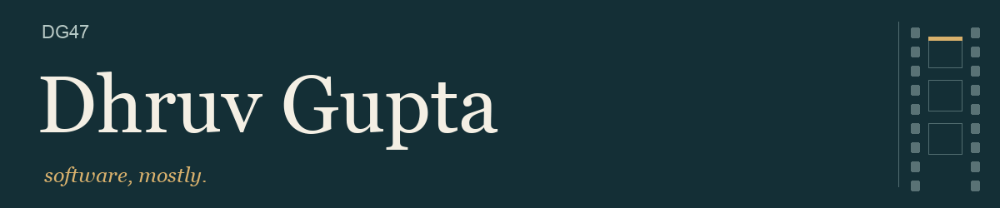

<picture>
  <source media="(max-width: 600px) and (prefers-reduced-motion: reduce)" srcset="assets/editorial/nameplate-mobile-still.png">
  <source media="(prefers-reduced-motion: reduce)" srcset="assets/editorial/nameplate-still.png">
  <source media="(max-width: 600px)" srcset="assets/editorial/nameplate-mobile.gif">
  
</picture>

I like understanding how things work. Occasionally this becomes everyone else’s problem in the form of a pull request.

I'm a founding engineer at **Sparx**, doing a bit of everything across backend, frontend, data, and infrastructure. My work includes healthcare data and Medicare claims. Before that: healthcare ML, computer vision, and assistive robotics.

I also help maintain [dbt-duckdb](https://github.com/duckdb/dbt-duckdb).

## Some work out in the world

Twenty-five projects, more than fifty merged fixes. The links go to the actual changes.

**Tuva · Medicare claims** 
Missing denial codes were causing claim lines to disappear. [Kept those lines](https://github.com/tuva-health/medicare_cclf_connector/pull/109), [corrected procedure-code mappings](https://github.com/tuva-health/medicare_cclf_connector/pull/107), and [fixed a provider-key join for Part A revenue lines](https://github.com/tuva-health/medicare_cclf_connector/pull/111) in the CCLF connector.

**dbt-duckdb · the DuckDB adapter** 
Contracted models [quote their column names](https://github.com/duckdb/dbt-duckdb/pull/856), external write options [match case-insensitively](https://github.com/duckdb/dbt-duckdb/pull/869), and attachments declared as `type: ducklake` [are recognised as DuckLake](https://github.com/duckdb/dbt-duckdb/pull/881).

**OHDSI · the OMOP stack** 
In WebAPI, the drug concept hierarchy [only counts standard ingredients](https://github.com/OHDSI/WebAPI/pull/2566) and the condition treemap [shows the right level-1 names](https://github.com/OHDSI/WebAPI/pull/2559). SqlRender [translates DATEDIFF with time units](https://github.com/OHDSI/SqlRender/pull/407) for DuckDB and SQLite.

**OHDSI DatabaseConnector · transaction cleanup** 
A query, insert, or batch-fetch error could leave the JDBC connection in a broken transaction. [Restored auto-commit after those failures](https://github.com/OHDSI/DatabaseConnector/pull/345), so the next operation can proceed.

**highdicom · DICOM structured reports** 
SR content items with [WAVEFORM references](https://github.com/ImagingDataCommons/highdicom/pull/473) and [NUM items without a value](https://github.com/ImagingDataCommons/highdicom/pull/476) parse again, and Key Object Selection documents [reject evidence from more than one study](https://github.com/ImagingDataCommons/highdicom/pull/503), as the standard requires.

**Phileas · PHI redaction** 
Day-first dates with a comma [are detected](https://github.com/philterd/phileas/pull/465), and the [ABA, Verhoeff and Damm check-digit validators](https://github.com/philterd/phileas/pull/473) are implemented instead of stubbed.

**Pandera · decimal precision** 
Polars decimal coercion was silently losing precision through an unnecessary Float64 intermediate. [Removed that conversion](https://github.com/unionai-oss/pandera/pull/2574). The digits were there for a reason.

**Synthea · complete synthetic claims exports** 
Historical synthetic claims referenced payer records that weren't being exported. [Included the referenced pre-1970 insurance-plan history](https://github.com/synthetichealth/synthea/pull/1734), keeping those references intact.

**Apache PyIceberg · partitioned writes** 
Arrow string and binary view types worked until partitioning got involved. [Enabled partitioned writes with those types](https://github.com/apache/iceberg-python/pull/4121), including nested columns from Polars/Arrow.

## And the “mostly”

I [made a movie](https://youtu.be/S2IAEMNz15M?si=9aKyHHl7XCpn-eSz). Not everything needs to be a repo.

Real Madrid. That part isn’t open for discussion.

Driving, traveling, and turning a five-minute question into an unreasonable amount of research. I could get a more normal hobby, but here we are.

[Email](mailto:todhruvg@gmail.com) · [LinkedIn](https://www.linkedin.com/in/DG47/) for the version wearing a collar.
